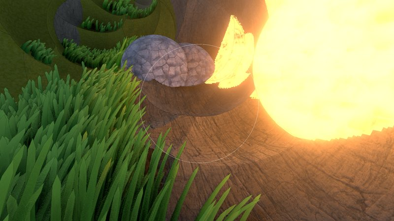
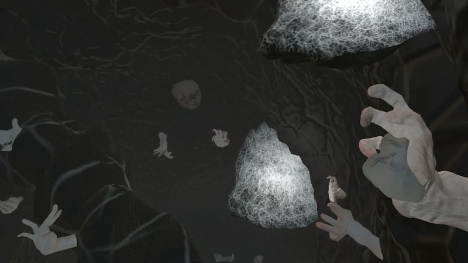
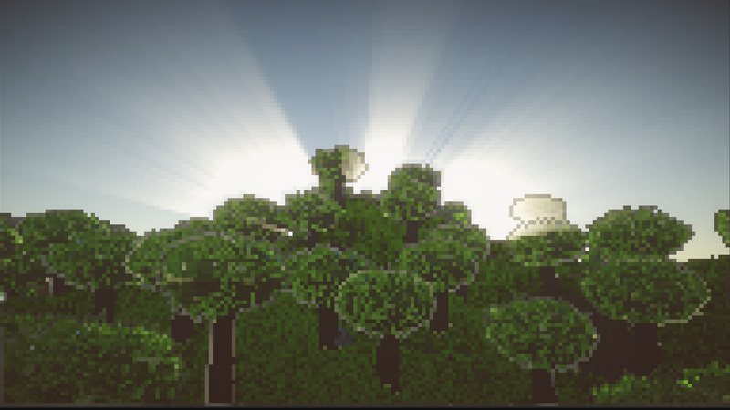
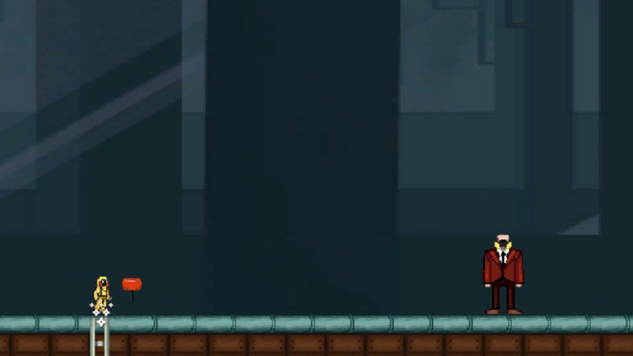

  

  <b>I build games and the engines underneath them.</b> 
  CS @ UC Irvine · voxels, falling sand, shaders, and whatever breaks next

  

## Featured work

<table>
  <tr>
    <td width="50%" valign="top">
      
      <h3><a href="https://github.com/WMsans/voxel-everything">Voxel Everything</a></h3>
      Destructible smooth-SDF terrain for Godot 4: 5 cm voxels, a raymarched near field, a meshed far field out to about 4 km, and severed chunks with real physics.
        <code>C++</code> <code>Godot</code> <code>GPU compute</code>
    </td>
    <td width="50%" valign="top">
      
      <h3><a href="https://github.com/WMsans/Jacks_Ascent">Jack's Ascent</a></h3>
      A VR horror game about climbing, built for Meta Quest-class headsets. Look up, keep moving, and don't fall. <a href="https://youtu.be/37_8r6TYhKo">Watch the demo</a>.
        <code>C#</code> <code>Unity</code> <code>VR</code>
    </td>
  </tr>
  <tr>
    <td width="50%" valign="top">
      
      <h3><a href="https://github.com/WMsans/RayTraceVoxel">RayTraceVoxel</a></h3>
      A compute-shader voxel engine that generates worlds on the GPU and supports editing with structural integrity.
        <code>C#</code> <code>Unity</code> <code>Compute shaders</code>
    </td>
    <td width="50%" valign="top">
      
      <h3><a href="https://github.com/WMsans/Nuclear-Kong">Nuclear-Kong</a></h3>
      A pixel-art arcade game with a boss fight, built and shipped in a single session for a game-jam lightning round.
        <code>C#</code> <code>Unity</code> <code>Game jam</code>
    </td>
  </tr>
</table>

## More from the workshop

| Project | What it is | Built with |
|---|---|---|
| [Falling-Sand Engine](https://github.com/WMsans/noita-engine) | Pixel-world simulation with materials, reactions, and rigid bodies | C++, Godot |
| [biu](https://github.com/WMsans/biu) | Sokoban-inspired puzzle game where explosions are how you move | Godot, C# |
| [OpenPix](https://github.com/WMsans/openpix) | Linux screenshot tool with on-device OCR, scroll capture, and annotation | C++17, Qt6, Wayland |
| [my-editor](https://github.com/WMsans/my-editor) | Serverless peer-to-peer collaborative editor with a plugin system | Tauri, React, Yjs, libp2p |
| [DevLog Generator](https://github.com/WMsans/DevLogGenerator) | Turns a project's git history into narrated devlog videos | Python, local LLM |
| [Vector Search](https://github.com/WMsans/vector_search) | Semantic search over Google Drive that runs entirely in the browser | JavaScript |
